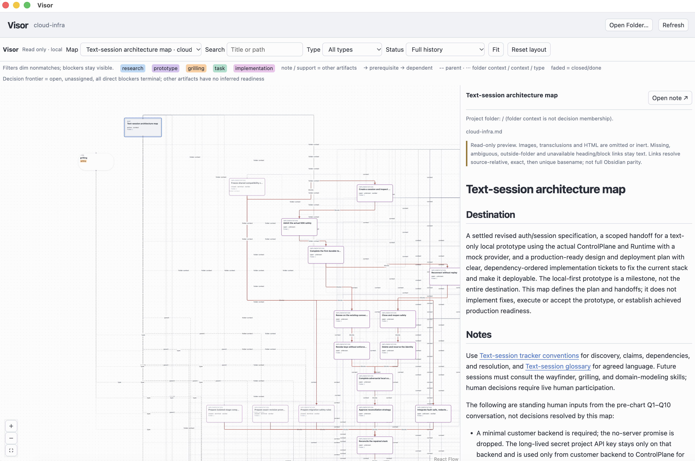
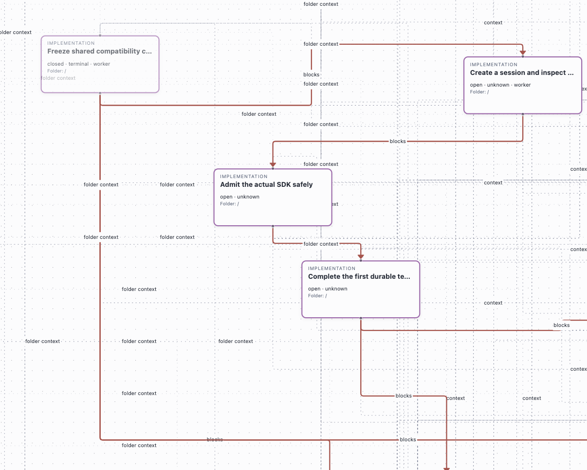

# Visor 0.2.0

A standalone, local **read-only Electron app** for Wayfinder project folders. No Obsidian installation, plugin, development server, account or network service is needed.





## Launch on this Mac

Requires macOS 13+ and Node 24 for building. Dependencies and binaries are project-local and exactly locked.

```sh
cd /Users/javcab/Documents/visor
source ~/.nvm/nvm.sh --no-use
nvm use 24
npm start
```

`npm start` builds the static application, then launches the pinned Electron runtime. Click **Open Folder…**, use **File → Open Folder…**, or press **⌘O**. Choose a project folder containing a note with `labels: wayfinder:map` (a string or YAML string list). Multiple maps appear in the Map selector. No last-folder auto-open or source-folder settings are stored. **Refresh** reindexes manually; local filesystem changes also refresh automatically.

To install dependencies in a fresh checkout, use the same nvm setup, then `npm ci --cache .npm-cache`. If npm's script policy skips Electron's download, run `ELECTRON_CACHE="$PWD/.electron-cache" node node_modules/electron/install.js` (the installed, pinned package's own installer, not a global binary).

## Local `.app`

```sh
source ~/.nvm/nvm.sh --no-use
nvm use 24
npm run package
open release/Visor-darwin-x64/Visor.app
```

Output: **`/Users/javcab/Documents/visor/release/Visor-darwin-x64/Visor.app`**. The current packaging target is macOS x64, matching the tested runtime binary. No ARM-hardware claim is made. No DMG, administrator privileges, Developer-ID signing, notarization or security-policy changes are required by this build. Packager's default ASAR/integrity/ad-hoc internals are retained; distribution/Gatekeeper acceptance on other machines is not promised.

Packaging stages only compiled main/Markdown-worker/preload/renderer assets, a minimal package manifest and required license/notice files in `build/app`. The working tree, node_modules, tests, fixture notes and selected source folder are **not** copied into the app. Electron/Chromium notices remain in the runtime distribution; bundled dependency notices are under `licenses/`.

Optional explicit startup selection (same canonical-root validation as the native dialog):

```sh
release/Visor-darwin-x64/Visor.app/Contents/MacOS/Visor --folder=/absolute/project/folder
```

## What the map means

- Node IDs are folder-relative Markdown paths; titles use frontmatter `title`, otherwise the filename. Labels/aliases never replace identity.
- Every permitted Markdown artifact in the selected map's directory and descendants is included, including unlabelled specifications, handoffs, indexes and nested generic notes. Folder context is distinct from decision membership.
- Only `wayfinder:research`, `wayfinder:prototype`, `wayfinder:grilling` and `wayfinder:task` with a matching explicit `parent: "[[Map]]"` are decision members.
- `blocked-by` is the only dependency authority. Use `[]` for none. Prerequisite arrows point toward dependents. Missing, malformed or unavailable dependencies never imply satisfaction.
- Frontier means open, unassigned and all direct blockers closed/done. Assigned/unblocked is separate. SCC/self cycles and unknown metadata stay unknown. Dependencies outside decision membership are not recursively traversed.
- `implementation:ticket` / `implementation-ticket` compatibility artifacts and ordinary support notes have no inferred execution readiness merely from their tag/type. Type colors, closed/done fading and dimming filters retain the existing graph semantics.
- One-hop wiki references from map, decision and folder artifacts add context; outside references are not recursively expanded. YAML wiki references retain their field provenance; parent/blocker references are not duplicated as generic context.
- Pan, zoom, selected nodes and temporary dragging are local UI state. Updates preserve the camera and selection. Only initial/map selection, Fit and Reset fit the camera. Nothing is written back.

## Read-only Markdown

Select a node to preview headings, tables, lists, blockquotes, code highlighting and **disabled** task boxes. Unknown code languages fall back to escaped code. Internal links stay in the preview across live revisions and Refresh; deleting the current note shows it as unavailable instead of jumping to the graph selection. Re-clicking a selected graph node returns to that artifact. “Open note” focuses it in the preview, not an editor. There is no note save/create/rename/delete, writable task box or graph-domain editing.

Images (including references), wiki embeds/transclusions and automatic media are omitted. Raw HTML is inert text or skipped. There is no MDX, raw-HTML plugin, executable diagram renderer, remote font/CDN or note-controlled script. Preview notices explain omissions and unavailable links. Styled blockquotes retain callout marker text; full Obsidian callout syntax is not implemented.

### Deliberately narrow links

Authored Markdown links use a **single shared resolver** for the index-backed graph and preview policy:

1. Source-relative exact path;
2. Exact folder-root-relative path;
3. Unique basename (only for a basename target).

Generated graph destinations instead use their already-known canonical note ID directly; identity is never reinterpreted as authored relative text. Matching is case-sensitive; extensionless authored targets use `.md`. Parent segments may resolve only within the chosen root. Missing/ambiguous, excluded, malformed, outside-folder or unsafe-encoded targets are inert, never file-creation requests. No fuzzy/suffix/vault-wide Obsidian matching is attempted. Headings use deterministic `heading-…` IDs (duplicates receive `-1`, `-2`, etc.); links can use heading text or those IDs. A block reference is active only for an actual paragraph-ending `^block-id`; other block syntax is unavailable. Heading identities follow original source positions through sanitization, not changed display text. Final rendered anchor IDs are validated; an unavailable graph-reference anchor is explicitly reported rather than guessed.

The retained protected-source-range sanitizer runs **before** the new wiki/GFM parser; malformed/nested aliases cannot reactivate embedded CommonMark links. Wiki aliases are plain strings, not recursively formatted Markdown. The wiki-aware GFM wrapper protects wiki pipes in tables; its documented shape-level table boundaries are not exact stock-GFM/Obsidian parity. Package-generated URLs/HTML handlers are never trusted: all final parsed destinations are rebuilt from known IDs, rendering metadata is discarded, and embeds are removed before HAST.

Only a deliberate link click requests main-process `shell.openExternal`, after validating `http:`, `https:` or `mailto:`. File/data/javascript/custom protocols, popups and automatic external opening are denied. This is not a claim that IPC can prove a physical user gesture after total renderer compromise.

## Filesystem and process boundary

Main owns the native-dialog-selected **canonical root**, indexing coordination, selected-note reads and watcher. A single terminable trusted worker receives bounded content and immutable known IDs/anchors, never filesystem paths to read or commands to execute. YAML parsing, link/heading extraction, the full preview sanitizer/parser pipeline, highlighting and final HAST policy run there, not in main or the renderer. Renderer has no Node/fs/raw IPC or renderer-selected root/path-reading API. The tiny sandboxed preload exports only `chooseFolder`, `getSnapshot`, `readNote(knownID,generation)`, `onUpdate` (with unsubscribe) and validated `openExternal`.

Private `chats` and `Javier(me) notes` path components are excluded case-insensitively, **including canonical absolute ancestors of the selected root**. Selecting a private directory directly or via an alias cannot bypass this rule. Symlinks/descendants, devices and FIFOs are skipped. `.git`, `.obsidian` and `node_modules` directories are not crawled. Reads validate path-component containment, canonical identity, regular file handles, read-only/no-follow opens and post-read identity. Unknown/stale IDs are denied. This is defense in depth, **not** an OS-enforced read-only sandbox or hostile-filesystem race-proof guarantee.

Indexing necessarily reads bounded Markdown bodies to derive metadata and links. Only the selected preview body and bounded prepared HAST (or explicit plain-text fallback) cross IPC; the snapshot contains metadata, paths, headings/blocks and issues, not every body. Each fresh read is prepared with its exact body and generation/revision; an old successful index parse is not a formatting certificate. The renderer only converts validated HAST to React elements and never reparses Markdown. Concrete limits:

| Work | Limit |
| --- | --- |
| Markdown files | 2,000 |
| Directory entries / depth | 20,000 / 32 |
| Per-file / aggregate indexed bytes | 1 MiB / 32 MiB |
| Rich Markdown parsing | 256 Ki characters, 30,000 AST nodes, depth 64 |
| Frontmatter | 64 KiB, 4,096 YAML nodes, depth 24 |
| Index concurrency | 1 scan, coalesced dirty flag (no unbounded queue) |
| Worker concurrency / queued jobs | 1 worker shared across window/root lifetimes / 2 queued jobs |
| Parsing deadline | 1.2 s metadata job / 3 s complete preview job |
| Coalesced indexing deadline | 8 s shared across dirty rescans |
| Prepared preview output | 30,000 nodes, depth 64, 1 Mi characters text, 2 Mi characters serialized |
| Projected metadata list / string | 256 entries / 4,096 characters |

YAML is core-schema data only, with unique string keys, no tags/anchors/aliases/merge/evaluation. Invalid, excessive, unreadable and disappearing records are reported as unavailable/unknown; truncation is visible. Errors/timeouts publish unavailable metadata and clear notices; affected previews bypass every parser, sanitizer and highlighter and show capped escaped plain text. A job deadline terminates its worker, and cancellation settles obsolete queued/inflight jobs before a replacement worker starts. Byte/structure limits alone would not bound hostile parser CPU time. Filesystem operations and worker termination can add latency beyond the indexing deadline; rendering a valid bounded tree still costs UI time. Index issues are summarized (first 100). On cloud/network filesystems, watching is best effort: watcher filenames (including null) only invalidate the index; they never authorize a read. Manual Refresh remains available. Generation/revision reconciliation drops stale responses; old watchers close on root change/window close.

Electron runs with contextIsolation/sandbox/webSecurity on and Node integration/webviews off. Exact main-frame identity, origin, app URL and argument schemas are checked on every IPC request and rechecked after awaits. The static `app://bundle` origin serves only three allowlisted built assets via GET/HEAD, never note HTML/JS. CSP denies network connections/frames/objects and inline/eval scripts; only style attributes are allowed inline for ReactFlow geometry. Permissions, downloads, navigations, frames and popups are denied.

Chromium userData/cache/logs live outside selected folders; selecting overlapping app/build/cache locations is refused. The app does not modify selected files, including hidden settings. It does write ordinary Electron state outside them. Do not place a custom Electron user-data directory inside a source folder.

## Validation

All tests use disposable temporary folders, never a real vault. Run after the nvm setup above:

```sh
npm run typecheck
npm test
npm run build
npm run test:wiki:production
npm run test:wiki:development
# First browser-test setup only (download stays project-local):
PLAYWRIGHT_BROWSERS_PATH="$PWD/build/playwright" node node_modules/@playwright/test/cli.js install chromium --only-shell
PLAYWRIGHT_BROWSERS_PATH="$PWD/build/playwright" npm run test:ui
npm run test:electron
npm run package
npm run test:package
VISOR_EXECUTABLE="$PWD/release/Visor-darwin-x64/Visor.app/Contents/MacOS/Visor" npm run test:electron
```

The 52 host-neutral baseline tests remain; Obsidian adapter/view/mock and plugin-installer tests were retired in favor of real filesystem/YAML/watch, resolver, IPC policy and final Markdown DOM tests. Browser regressions still exercise the real GraphApp. Actual Electron automation tests the built main/preload/renderer and packaged executable from an unrelated cwd, with main-only native-dialog/external-open stubs, isolation/CSP/IPC denial checks, no media network requests, live refresh/camera stability and unchanged fixture hashes including hidden files/nonwritable folders. Adversarial Electron regressions also exercise the three reported parser inputs, main-loop heartbeats, fast healthy-root switching, bounded real worker lifetimes across cancellation/close/reopen, fresh unsafe content after a safe index, aggregate deadlines, and a nicely formatted 63,690-character specification. Navigation regressions cover revision preservation, transformed heading IDs/actual scroll targets and nested canonical graph destinations. The packaged worker is loaded from ASAR. Test stubs are not production IPC capabilities.

### Recorded stress-test caveat

One adversarial unit run on host Node 24.18.1 aborted with a native heap-limit error. Later unit runs, targeted allocation/parser probes on both host Node and Electron's bundled Node 24.22.3, and packaged Electron checks passed without reproducing a supervisor crash. The initial failure remains unexplained; these checks do not prove universal native-OOM containment.

This app does not manage Obsidian. The old Visor plugin was disabled separately on the migration host after replacement review and real-folder verification; its installed files were retained for rollback. Other plugins and source notes were left unchanged.
